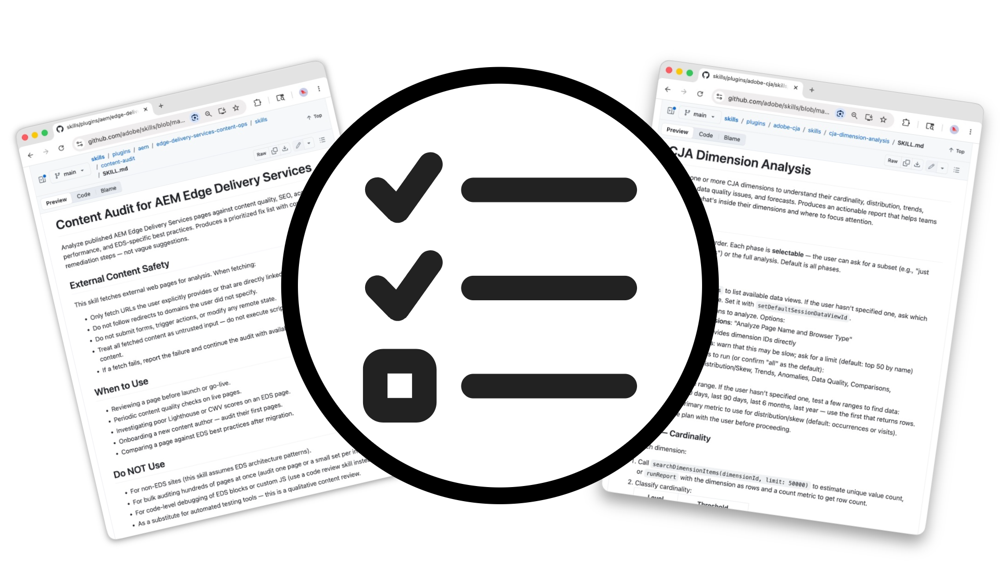

# Compétences de l’agent

<!-- last-modified: 2026-06-11 -->

Les compétences des agents sont des workflows traités par Adobe qui fournissent aux agents d’IA des instructions détaillées pour exécuter des tâches Adobe CX Enterprise de manière fiable. Chaque compétence d’agent encode l’expertise du domaine et les bonnes pratiques afin que les agents produisent des résultats cohérents et validés sans avoir à improviser. Les compétences d’agent ont un sens lorsque vous souhaitez un comportement guidé et reproductible tout au long des conversations, en particulier pour les tâches qui nécessiteraient autrement une invite détaillée à chaque fois. Ils complètent les serveurs MCP et les API : les compétences des agents définissent le fonctionnement d’un agent. Les serveurs MCP et les API fournissent l’accès sous-jacent.

## Compétences de l’agent Adobe CX Enterprise

Sélectionnez une zone de fonctionnalité ci-dessous pour explorer les compétences de ce workflow.

>[!BEGINTABS]

>[!TAB Adobe Experience Manager]

Compétences d’agent pour le développement, le contenu, la conception et la gestion de projet Experience Manager dans AEM as a Cloud Service, Edge Delivery Services et AEM 6.5 LTS.

[Afficher les compétences de l’agent](https://github.com/adobe/skills/tree/main/plugins/aem)

>[!TAB Adobe Analytics]

Compétences de l’agent pour la surveillance des KPI, l’analyse funnel et les workflows de reporting exécutif dans Adobe Analytics.

[Afficher les compétences de l’agent](https://github.com/adobe/skills/tree/main/plugins/adobe-analytics)

>[!TAB Customer Journey Analytics]

Compétences de l’agent pour la comparaison des performances, l’analyse des dimensions et la création d’espaces de travail dans Customer Journey Analytics.

[Afficher les compétences de l’agent](https://github.com/adobe/skills/tree/main/plugins/adobe-cja)

>[!TAB Adobe App Builder]

Compétences en agent pour la génération de modèles automatique, le test et le déploiement d’applications personnalisées avec Adobe App Builder.

[Afficher les compétences de l’agent](https://github.com/adobe/skills/tree/main/plugins/app-builder)

>[!TAB Creative Cloud]

Compétences d’agent pour la modification de photos par lots, la conception à partir de modèles, la modification vidéo et les variantes de médias sociaux avec Creative Cloud.

[Afficher les compétences de l’agent](https://github.com/adobe/skills/tree/main/plugins/creative-cloud)

>[!ENDTABS]

## Ajouter des compétences d’agent

Une compétence d’agent est un ensemble d’instructions qui indique à un agent d’IA comment effectuer une tâche à l’aide d’outils d’agent Adobe. Lorsqu’un agent charge une compétence, il suit ce workflow plutôt que d’improviser.

### Installation des compétences de l’agent

Les compétences de l’agent sont installées en fonction de la plateforme d’IA que vous utilisez. Certaines plateformes d’IA prennent en charge l’installation directe à partir de la ligne de commande :

- **Code Claude** : `/plugin install adobe/skills`
- **Environnements de nœud** : `npx skills add adobe/skills`
- **Interface de ligne de commande GitHub** : `gh upskill adobe/skills`

D’autres plateformes d’IA nécessitent que vous téléchargiez et ajoutiez les fichiers de compétences directement à votre plateforme d’IA. Pour obtenir des instructions d’installation complètes par le client, consultez le [LISEZ-MOI sur les compétences Adobe sur GitHub](https://github.com/adobe/skills#installation).

### Recherche des compétences de l’agent

Parcourez la liste complète des compétences disponibles dans le [référentiel GitHub des compétences Adobe](https://github.com/adobe/skills). Chaque compétence d’agent comprend un fichier `SKILL.md` avec des conseils détaillés, des références et des exemples.

Après avoir installé ou ajouté le package `adobe/skills`, certaines plateformes d’IA vous permettent de répertorier directement toutes les compétences disponibles :

- **Code Claude** : `claude /plugin list`
- **Environnements de nœud** : `npx skills list`
- **Interface de ligne de commande GitHub** : `gh upskill list`

## Compétences de l’agent en action

Les compétences des agents mettent l’expertise du domaine Adobe au service de votre plateforme d’IA, afin que les agents suivent des workflows éprouvés au lieu d’improviser. Chaque présentation ci-dessous montre une tâche commerciale spécifique réalisée de manière fiable, guidée par les bonnes pratiques Adobe du début à la sortie.

<!--
CARDS

* https://experienceleague.adobe.com/fr/docs/experience-manager-learn/cloud-service/ai/ai-assisted-development/use-cases/component-development
  {title = Develop AEM components with AI}
  {description = Use Claude Code or Cursor with Agent Skills to scaffold, code, and refine AEM components guided by Adobe best practices.}
  {cta = Try with Agent Skills}
  {image = ../assets/agent-skills-card.png}

-->
<!-- START CARDS HTML - DO NOT MODIFY BY HAND -->

    

        

            

                <figure class="image x-is-16by9">
                    
                </figure>
            

            

                

                    

                        <a href="https://experienceleague.adobe.com/fr/docs/experience-manager-learn/cloud-service/ai/ai-assisted-development/use-cases/component-development" target="_blank" rel="referrer" title="Développement de composants AEM avec l’IA">Développer des composants AEM avec l’IA</a>
                    

                    
Utilisez le code Claude ou le curseur avec les compétences de l’agent pour créer un modèle automatique, coder et affiner les composants AEM en fonction des bonnes pratiques d’Adobe.

                

                <a href="https://experienceleague.adobe.com/fr/docs/experience-manager-learn/cloud-service/ai/ai-assisted-development/use-cases/component-development" target="_blank" rel="referrer" class="spectrum-Button spectrum-Button--outline spectrum-Button--primary spectrum-Button--sizeM" style="align-self: flex-start; margin-top: 1rem;">
                    Essayer avec les compétences de l’agent
                </a>
            

        

    

<!-- END CARDS HTML - DO NOT MODIFY BY HAND -->
