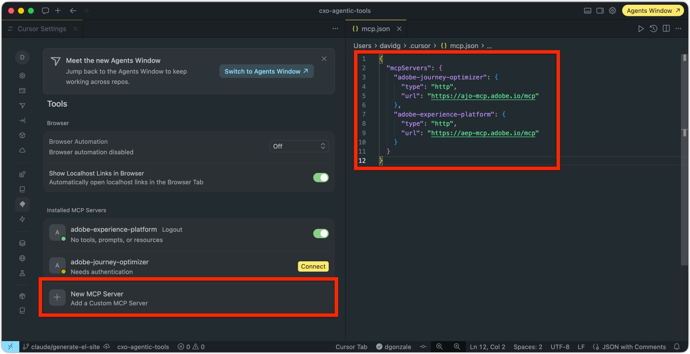
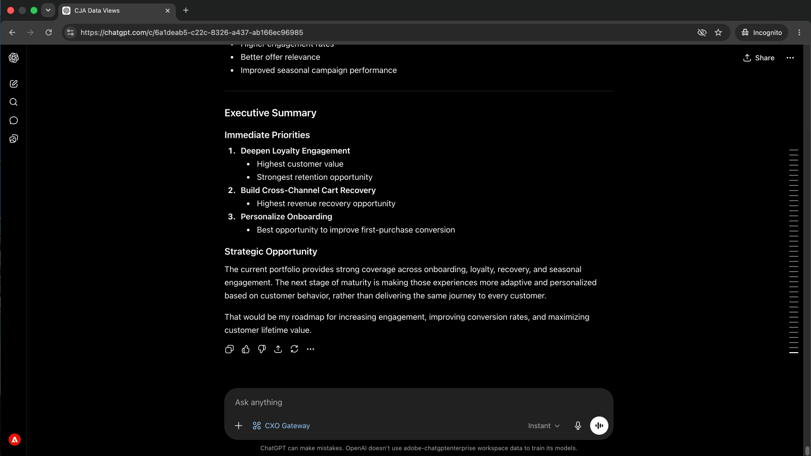
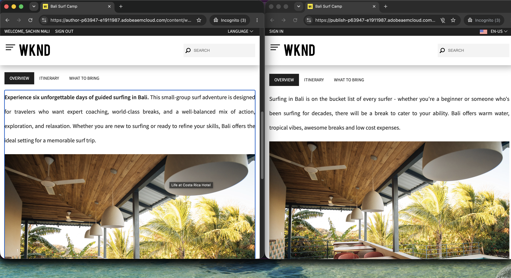

# Serveurs MCP

<!-- last-modified: 2026-09-16 -->

Les serveurs Adobe MCP donnent accès directement et régis aux données et aux workflows d’Adobe à toute plateforme d’IA compatible. Connectez-vous une seule fois et vous pourrez interroger les performances de la campagne, activer les audiences, passer en revue les parcours, gérer le contenu, etc., le tout en langage clair, sans quitter votre environnement d’IA. Les serveurs MCP se trouvant entre votre plateforme d’IA et les systèmes sous-jacents d’Adobe, vous bénéficiez d’une flexibilité en langage naturel tandis que les contrôles d’accès et la gouvernance des données de votre entreprise restent en vigueur.

Les serveurs Adobe MCP respectent la norme ouverte [Model Context Protocol](https://modelcontextprotocol.io/docs/getting-started/intro). Toute plateforme d’IA compatible avec MCP se connecte à tout serveur MCP Adobe.

>[!TIP]
>
>**Commencez avec Adobe CX Enterprise Coworker pour les plateformes d’IA.** Il s’agit de la meilleure façon d’utiliser Adobe MCP avec votre plateforme d’IA. Ajoutez un serveur MCP à Claude, ChatGPT, Microsoft 365 Copilot, Gemini Enterprise, etc., et utilisez Adobe CX Enterprise Coworker à partir de là.
>
>* **Une connexion, mais pas beaucoup.** Vous configurez un serveur MCP au lieu de connecter chaque application Adobe séparément.
>* **Votre accès, reporté.** Vous vous connectez avec vos informations d’identification Adobe et Coworker utilise l’accès que vous avez déjà. Il n’existe aucune configuration d’autorisations distincte.
>* **Sûr et régi par la conception.** Coworker donne à chaque utilisateur un accès contrôlé aux applications CX Enterprise situées derrière lui. Certains utilisateurs et utilisatrices peuvent avoir un accès en lecture seule à certains contenus ou données, tandis que d’autres ont un accès en lecture et en écriture, selon la configuration de leur utilisateur ou utilisatrice et l’accès qui leur a été accordé. [En savoir plus sur le contrôle d&#39;accès dans Coworker](https://experienceleague.adobe.com/en/docs/coworker/content/administration/access-control).
>
>Vous travaillez déjà sur d’autres plateformes d’IA et avez créé des workflows autour d’elles ? Vous pouvez également accéder aux fonctionnalités de Coworker à partir de ces plateformes, sans modifier votre façon de travailler. [Configurer Coworker pour les plateformes d’IA](#connect-to-your-ai-platform)
>
>Si ce n&#39;est pas une option pour vous, vous pouvez également [connecter directement votre plateforme d&#39;IA aux serveurs MCP du produit](#connect-to-your-ai-platform).

## Serveurs MCP de CX Enterprise {#cx-enterprise-mcp-servers}

>[!CONTEXTUALHELP]
>id="cx-enterprise-agentic-tools_mcp_servers_cx-enterprise"
>title="Coworker"
>abstract="Demandez, analysez et agissez en langage clair dans toutes vos applications CX Enterprise, sans configuration de serveur. Pour les applications individuelles disposant de leur propre serveur MCP, connectez-vous directement à la place."
>additional-url="https://experienceleague.adobe.com/fr/docs/cx-enterprise-coworker/content/home" text="Documentation des collègues"


Il existe trois façons de travailler avec vos applications CX Enterprise par le biais de l’IA. Explorez-les dans cet ordre :

1. **Collègue.** Le moyen le plus rapide de travailler dans vos applications CX Enterprise. Il est compatible avec eux, sans configuration de serveur, sans point d’entrée à enregistrer et sans configuration de plateforme d’IA. [Essayer Un Collègue](https://experienceleague.adobe.com/fr/docs/cx-enterprise-coworker/content/home)
2. **Collègue pour les plateformes d’IA.** Si vous ne pouvez pas ou ne souhaitez pas utiliser directement Coworker, utilisez-le à partir de votre propre plateforme d’IA, telle que Microsoft 365 Copilot, ChatGPT ou Claude. [Configurer Coworker pour les plateformes d’IA](#connect-to-your-ai-platform)
3. **Serveurs MCP de produit.** Si aucune option ne fonctionne pour vous, connectez directement votre plateforme d’IA au serveur MCP pour une application Adobe spécifique. [Connexion à un serveur MCP de produit](#connect-to-your-ai-platform)

Plusieurs applications possèdent leur propre serveur MCP.

| Serveur MCP | Point d’entrée | Ce que vous pouvez faire | Également via Coworker |
| --- | --- | --- | --- |
| [Adobe Journey Optimizer](https://experienceleague.adobe.com/en/docs/experience-cloud-ai/experience-cloud-ai/mcp/mcp-product-tools/ajo-mcp) | `https://ajo-mcp.adobe.io/mcp` | Examiner les configurations des parcours, des campagnes et des canaux | Oui |
| [Customer Journey Analytics](https://experienceleague.adobe.com/en/docs/experience-cloud-ai/experience-cloud-ai/mcp/mcp-product-tools/cja-mcp) | `https://cja-mcp.adobe.io/mcp` | Requête sur les rapports, découverte des vues de données et création d’espaces de travail | Oui |
| [Adobe Analytics](https://experienceleague.adobe.com/en/docs/experience-cloud-ai/experience-cloud-ai/mcp/mcp-product-tools/analytics-mcp) | `https://aa-mcp.adobe.io/mcp` | Découverte de suites de rapports, création de segments et création d’espaces de travail | Oui |
| [Adobe Target](https://experienceleague.adobe.com/en/docs/target/using/mcp/target-mcp) | `https://targetmcp.adobe.io/mcp` | Examinez les activités, les offres, les audiences, les mbox, les rapports de performances et les URL de prévisualisation (bêta publique : les outils sont en lecture seule et les outils d’écriture sont prévus pour la disponibilité générale). | Oui |
| [Real-Time CDP](https://experienceleague.adobe.com/en/docs/experience-platform/rtcdp/intro/rtcdp-mcp) | `https://rtcdp-mcp.adobe.io/mcp` | Rechercher des audiences, des destinations, des sources et des exécutions de flux ; inspecter les espaces de noms d’identité et les politiques de fusion (bêta publique : place sur la liste autorisée requise, tous les outils sont en lecture seule). | Oui |
| [Serveur AEM MCP](https://experienceleague.adobe.com/fr/docs/experience-manager-learn/cloud-service/ai/mcp-servers/overview) | `https://mcp.adobeaemcloud.com/adobe/mcp/aem` | Gérer les pages, les fragments de contenu, les ressources et les lancements ; évaluer le contenu et les images par rapport aux directives de la marque et aux règles de conformité | Oui |
| [AEM Cloud Manager](https://experienceleague.adobe.com/fr/docs/experience-manager-learn/cloud-service/ai/mcp-servers/cloud-manager) | `https://mcp.adobeaemcloud.com/adobe/mcp/cloudmanager` | Gestion des programmes, environnements, pipelines et référentiels | Non |
| Adobe Marketing Agent | `https://aep-ai-ama.adobe.io/mcp` | Orchestrer l’analyse des audiences, les diagnostics AEP et la création de parcours B2B AJO dans les applications AEP | Non |
| [Adobe Workfront](https://experienceleague.adobe.com/en/docs/workfront/using/basics/workfront-mcp-server/workfront-mcp-server-overview) | `https://mcp.prod.us-west-2.aws.wfk8s.com/mcp/v1/workfront` | Gérer le travail, les projets, les enregistrements de planification, les informations et les approbations de contenu | Non |
| [Marketo Engage](https://experienceleague.adobe.com/en/docs/marketo-developer/marketo/mcp-server) | `https://marketo-mcp.adobe.io/mcp` | Gérez les formulaires, les campagnes intelligentes, les prospects, les listes, les programmes, les e-mails et les opérations en bloc | Oui |
| Adobe Experience Platform | Via [Collègue](https://experienceleague.adobe.com/fr/docs/cx-enterprise-coworker/content/home) | Découverte de jeux de données, navigation dans les schémas et gestion des sandbox | S.O. |
| Campaign Classic | Via [Collègue](https://experienceleague.adobe.com/fr/docs/cx-enterprise-coworker/content/home) | Découverte des instances Campaign, navigation dans les schémas, exécution des requêtes, contrôle des workflows et exécution de SOAP/JS | S.O. |
| Expérimentation | Via [Collègue](https://experienceleague.adobe.com/fr/docs/cx-enterprise-coworker/content/home) | Rapports, mesures, informations, opportunités et planification de la taille des échantillons pour les expériences A/B, MVT et MAB | S.O. |
| GenStudio for Performance Marketing | Via [Collègue](https://experienceleague.adobe.com/fr/docs/cx-enterprise-coworker/content/home) | Accès aux données de performances publicitaires et aux informations créatives | S.O. |
| Adobe Journey Optimizer B2B Edition | Via [Collègue](https://experienceleague.adobe.com/fr/docs/cx-enterprise-coworker/content/home) | Gérez les parcours B2B, les programmes de compte, les groupes d’achats et la personnalisation | S.O. |

>[!NOTE]
>
>L’accès à chaque serveur MCP dépend des droits de votre entreprise pour cette application et des autorisations de votre utilisateur. Les cinq dernières lignes ne disposent pas encore de leur propre serveur MCP pour la connexion directe. Utilisez Coworker pour les joindre aujourd&#39;hui.

## Connexion à votre plateforme d’IA {#connect-to-your-ai-platform}

La plupart des serveurs Adobe MCP utilisent OAuth avec Adobe Identity Management Service (IMS). Sélectionnez l’organisation IMS appropriée lorsque vous y êtes invité. Le choix d’une mauvaise option est la source la plus courante d’erreurs d’authentification.


Si vous utilisez Coworker directement, rien de ce qui suit ne s&#39;applique à vous. Pour utiliser Coworker à partir de votre propre plateforme d’IA, commencez par l’onglet **Coworker pour les plateformes d’IA**. Les onglets restants permettent de connecter directement votre propre plateforme d’IA à un serveur MCP Adobe et d’utiliser le point d’entrée du serveur MCP AEM comme exemple. Le même processus s’applique à tout serveur Adobe MCP : remplacez l’URL du point d’entrée par celle du serveur auquel vous souhaitez vous connecter.

>[!BEGINTABS]

>[!TAB Coworker]

Coworker comprend déjà plusieurs de ces fonctionnalités MCP. Aucun serveur à ajouter, aucun point d’entrée à enregistrer et aucune plateforme d’IA à configurer. Connectez-vous à Coworker et il est prêt à être utilisé.

Documentation complète : [Documentation de Coworker](https://experienceleague.adobe.com/fr/docs/cx-enterprise-coworker/content/home)

>[!TAB Collègue pour les plateformes d’IA]

Coworker pour les plateformes d’IA est un serveur MCP qui connecte votre plateforme d’IA à Coworker. Tout ce qui est disponible dans Coworker l’est également. Vous utilisez votre plateforme d’IA, telle que Claude, ChatGPT, Microsoft 365 Copilot ou Gemini Enterprise, comme interface de chat, et Coworker effectue le travail en arrière-plan, de la même manière que lorsque vous utilisez Coworker directement.

>[!VIDEO](https://video.tv.adobe.com/v/3508455/?learn=on&enablevpops)

Vous vous connectez avec vos informations d’identification Adobe et Coworker utilise l’accès lié à votre identité Adobe. Coworker est sûr et régi par la conception. Ce que vous pouvez lire ou modifier dépend de la configuration de votre utilisateur, de l’accès qui vous est accordé dans Coworker et de l’accès accordé dans les applications que Coworker utilise en votre nom. Voir [Contrôle d&#39;accès pour Coworker](https://experienceleague.adobe.com/en/docs/coworker/content/administration/access-control).

Avant de commencer, vérifiez les points suivants :

* Un collègue est configuré pour votre organisation et vous y avez accès dans Adobe.
* Votre organisation dispose de Adobe Experience Platform et d’au moins l’une des solutions suivantes : Adobe Real-Time CDP, Adobe Journey Optimizer ou Adobe Customer Journey Analytics.
* Vous avez accès à une plateforme d’IA prise en charge.

Le point d&#39;entrée du serveur est `https://mcp.coworker.experience.adobe.io`. La configuration diffère selon la plateforme d’IA et commence généralement par une approbation d’Adobe CX Enterprise Coworker par un administrateur pour votre organisation. [Configurer Coworker pour les plateformes d’IA](https://experienceleague.adobe.com/en/docs/coworker/content/ai-platforms#set-up-coworker)

>[!TAB Claude.ai]

###  Utiliser un connecteur géré

Accédez au [registre Adobe AI](https://developer.adobe.com/ai-registry/?type=connector) et recherchez votre application Adobe. Si un connecteur Claude est répertorié (par exemple, le [connecteur Adobe Experience Manager](https://developer.adobe.com/ai-registry/#/connectors/adobe-experience-manager-connector)), suivez ses instructions de configuration au lieu des étapes ci-dessous.

### Se connecter à l’aide d’un connecteur personnalisé

Claude.ai prend en charge les serveurs MCP distants via des connecteurs personnalisés dans les paramètres du compte.

1. Accédez à **Paramètres > Intégrations**.
2. Cliquez sur **Ajouter un connecteur personnalisé**.
3. Saisissez le point d’entrée du serveur comme URL (par exemple, `https://mcp.adobeaemcloud.com/adobe/mcp/aem` pour le serveur MCP AEM) et un nom d’affichage de votre choix.
4. Cliquez sur **Connexion** et connectez-vous avec votre Adobe ID. Sélectionnez l’organisation IMS appropriée.

Configuration complète : [Documentation sur les connecteurs personnalisés Claude.ai](https://support.claude.com/en/articles/11175166-get-started-with-custom-connectors-using-remote-mcp)

>[!TAB Code Claude]

### Utilisation de l’interface de ligne de commande

Exécutez `claude mcp add` pour enregistrer un serveur MCP Adobe. Remplacez le nom et l’URL du serveur par les valeurs du serveur auquel vous souhaitez vous connecter. Cet exemple utilise le serveur AEM MCP :

```bash
claude mcp add --transport http adobe-aem https://mcp.adobeaemcloud.com/adobe/mcp/aem
```

### Modifier votre fichier de paramètres

Ajoutez le serveur à `~/.claude.json` (global) ou `.mcp.json` dans la racine de votre projet (au niveau du projet). Remplacez la clé et l’URL par les valeurs du serveur auquel vous souhaitez vous connecter :

```json
{
  "mcpServers": {
    "adobe-aem": {
      "type": "http",
      "url": "https://mcp.adobeaemcloud.com/adobe/mcp/aem"
    }
  }
}
```

Les serveurs Adobe MCP utilisent OAuth. Claude Code vous invite à vous authentifier auprès de votre Adobe ID la première fois que vous appelez un outil. Sélectionnez l’organisation IMS appropriée lorsque vous y êtes invité.

Configuration complète : [Documentation Claude Code MCP](https://docs.anthropic.com/en/docs/claude-code/mcp)

>[!TAB Curseur]

Ajoutez un serveur MCP Adobe à votre fichier de configuration Cursor `mcp.json`, puis connectez-vous via **Paramètres > MCP**. Remplacez la clé et l’URL par les valeurs du serveur auquel vous souhaitez vous connecter. Cet exemple utilise le serveur AEM MCP :

- **Global (tous les projets) :** `~/.cursor/mcp.json`
- **Niveau du projet :** `.cursor/mcp.json` dans la racine de votre projet

```json
{
  "mcpServers": {
    "adobe-aem": {
      "type": "http",
      "url": "https://mcp.adobeaemcloud.com/adobe/mcp/aem"
    }
  }
}
```

Une fois ajoutés, les serveurs MCP apparaissent sous **Serveurs MCP installés** dans les paramètres du curseur. Sélectionnez **Connexion** en regard de tout serveur affichant **Nécessite une authentification** et connectez-vous avec votre Adobe ID. Sélectionnez l’organisation IMS ayant accès à l’application.



Configuration complète : [Documentation Cursor MCP](https://cursor.com/docs/mcp)

>[!TAB ChatGPT]

###  Utiliser un connecteur géré

Accédez au [registre Adobe AI](https://developer.adobe.com/ai-registry/?type=connector) et recherchez votre application Adobe. Si un connecteur ChatGPT est répertorié, suivez ses instructions de configuration au lieu des étapes ci-dessous.

### Se connecter à l’aide d’un serveur MCP distant

Demandez à votre administrateur ChatGPT d&#39;ajouter le serveur MCP pour votre organisation. Cela permet à chaque utilisateur de se connecter sans la configuration ci-dessous.

Si un administrateur ne peut pas l’ajouter ou si vous souhaitez que la connexion soit établie uniquement pour votre compte, procédez comme suit.

**Configuration ponctuelle :** activez le mode Développeur avant de pouvoir enregistrer une URL MCP personnalisée.

1. Accédez à **Paramètres > Sécurité et connexion**.
2. Activer le **mode Développeur**.

**Ajouter un serveur :**

1. Accédez à **Paramètres > Modules externes > Parcourir les modules externes**.
2. Sélectionnez **+** pour ajouter un nouveau plug-in.
3. Saisissez un nom, par exemple `AEM MCP Server` ou `Adobe Journey Optimizer`.
4. Saisissez une description.
5. Sélectionnez **URL du serveur**.
6. Sous **Connexion**, saisissez l’URL MCP Adobe complète. Par exemple, `https://mcp.adobeaemcloud.com/adobe/mcp/aem` pour AEM ou `https://ajo-mcp.adobe.io/mcp` pour Adobe Journey Optimizer.
7. Définissez **Authentification** sur **OAuth**.
8. Lisez et acceptez les conditions d&#39;utilisation.
9. Sélectionnez **Créer**.
10. Connectez-vous avec le compte Adobe ayant accès à l’application CX Enterprise à laquelle le serveur MCP se connecte.

Configuration complète : [Documentation du MCP ChatGPT](https://developers.openai.com/api/docs/guides/tools-connectors-mcp)

>[!TAB Interface de ligne de commande OpenAI Codex]

L’interface de ligne de commande OpenAI Codex prend en charge les serveurs MCP distants via la configuration TOML.

**Emplacements des fichiers de configuration :**

- **Niveau utilisateur (tous les projets) :** `~/.codex/config.toml`
- **Portée du projet :** `.codex/config.toml` dans la racine de votre projet

Remplacez le nom de section et l’URL par les valeurs du serveur auquel vous souhaitez vous connecter. Cet exemple utilise le serveur AEM MCP :

```toml
[mcp_servers.adobe-aem]
url = "https://mcp.adobeaemcloud.com/adobe/mcp/aem"
enabled = true
```

Les serveurs Adobe MCP utilisent OAuth. L’interface de ligne de commande du Codex gère automatiquement le flux OAuth lors de la première utilisation. Sélectionnez l’organisation IMS appropriée lorsque vous y êtes invité.

Configuration complète : [Documentation MCP de l’interface de ligne de commande OpenAI Codex](https://developers.openai.com/codex/mcp)

>[!TAB Copilot Studio]

Microsoft Copilot Studio se connecte aux serveurs MCP distants à l&#39;aide de l&#39;Assistant Intégration MCP, qui crée automatiquement un connecteur personnalisé Power Platform.

1. Ouvrez votre agent dans Copilot Studio.
2. Accédez à la page **Outils**.
3. Sélectionnez **Ajouter un outil > Nouvel outil > Protocole de contexte de modèle**.
4. Dans l’Assistant d’intégration MCP, saisissez les détails du serveur. Par exemple, pour le serveur MCP AEM :
   - **Nom du serveur :** `AEM`
   - **URL du serveur :** `https://mcp.adobeaemcloud.com/adobe/mcp/aem`
5. Définissez l’authentification sur **OAuth 2.0** et configurez-la avec vos URL d’autorisation et de jeton Adobe IMS.
6. Sélectionnez **Créer**, puis **Ajouter à l’agent**.

>[!NOTE]
>
>Les connexions au serveur MCP dans Copilot Studio passent par Power Platform. Les politiques de prévention des pertes de données (DLP) de votre entreprise s’appliquent.

Configuration complète : [Documentation Copilot Studio MCP](https://learn.microsoft.com/microsoft-copilot-studio/mcp-add-existing-server-to-agent)

>[!ENDTABS]

## Serveurs MCP en action

Voir les serveurs Adobe MCP mis au travail pour résoudre de réels problèmes d’entreprise. Chaque présentation commence à partir d’un véritable défi opérationnel et montre comment une plateforme d’IA le résout en langage simple, sans changer d’outil ni écrire de code.

<!--
CARDS

* ../use-cases/analyze-campaign-performance.md
  {title = Campaign insights without reports}
  {description = Ask performance questions in plain language and get answers from Customer Journey Analytics, without building a single report.}
  {cta = Surface campaign insights}

* ../use-cases/query-audiences.md
  {title = Audience activation at a glance}
  {description = See which audiences are live, where they are flowing, and whether destinations are healthy, without navigating Real-Time CDP.}
  {cta = Check audience activation}

* ../use-cases/manage-ajo-journeys.md
  {title = Catch journey issues early}
  {description = Monitor active journeys and surface operational issues before they reach your audience.}
  {cta = Monitor your journeys}

* ../use-cases/manage-aem-content.md
  {title = Ship content updates faster}
  {description = Find, update, and publish AEM pages and content fragments faster, without switching to the AEM interface.}
  {cta = Ship content faster}

* ../use-cases/optimize-content-with-performance-data.md
  {title = Close content performance gaps}
  {description = Surface conversion gaps in CJA, trace them to underperforming content in AEM, and apply the fix in a single AI session.}
  {cta = Close performance gaps}
-->

<!-- START CARDS HTML - DO NOT MODIFY BY HAND -->
<div class="columns">
    <div class="column is-half-tablet is-half-desktop is-one-third-widescreen" aria-label="Campaign insights without reports">
        <div class="card" style="height: 100%; display: flex; flex-direction: column; height: 100%;">
            <div class="card-image">
                <figure class="image x-is-16by9">
                    <a href="../use-cases/analyze-campaign-performance.md" title="Informations sur la campagne sans rapports">
                        
                    </a>
                </figure>
            </div>
            <div class="card-content is-padded-small" style="display: flex; flex-direction: column; flex-grow: 1; justify-content: space-between;">
                <div class="top-card-content">
                    <p class="headline is-size-6 has-text-weight-bold">
                        <a href="../use-cases/analyze-campaign-performance.md" title="Informations sur la campagne sans rapports">Informations de campagne sans rapports</a>
                    </p>
                    <p class="is-size-6">Posez des questions sur les performances en langage clair et obtenez des réponses de Customer Journey Analytics, sans créer de rapport unique.</p>
                </div>
                <a href="../use-cases/analyze-campaign-performance.md" class="spectrum-Button spectrum-Button--outline spectrum-Button--primary spectrum-Button--sizeM" style="align-self: flex-start; margin-top: 1rem;">
                    <span class="spectrum-Button-label has-no-wrap has-text-weight-bold">Informations sur la campagne de surface</span>
                </a>
            </div>
        </div>
    </div>
    <div class="column is-half-tablet is-half-desktop is-one-third-widescreen" aria-label="Audience activation at a glance">
        <div class="card" style="height: 100%; display: flex; flex-direction: column; height: 100%;">
            <div class="card-image">
                <figure class="image x-is-16by9">
                    <a href="../use-cases/query-audiences.md" title="Activation des audiences en un coup d’œil">
                        
                    </a>
                </figure>
            </div>
            <div class="card-content is-padded-small" style="display: flex; flex-direction: column; flex-grow: 1; justify-content: space-between;">
                <div class="top-card-content">
                    <p class="headline is-size-6 has-text-weight-bold">
                        <a href="../use-cases/query-audiences.md" title="Activation des audiences en un coup d’œil">Activation de l’audience en un coup d’œil</a>
                    </p>
                    <p class="is-size-6">Identifiez les audiences en direct, où elles circulent et si les destinations sont saines, sans naviguer dans Real-Time CDP.</p>
                </div>
                <a href="../use-cases/query-audiences.md" class="spectrum-Button spectrum-Button--outline spectrum-Button--primary spectrum-Button--sizeM" style="align-self: flex-start; margin-top: 1rem;">
                    <span class="spectrum-Button-label has-no-wrap has-text-weight-bold">Vérifier l’activation de l’audience</span>
                </a>
            </div>
        </div>
    </div>
    <div class="column is-half-tablet is-half-desktop is-one-third-widescreen" aria-label="Catch journey issues early">
        <div class="card" style="height: 100%; display: flex; flex-direction: column; height: 100%;">
            <div class="card-image">
                <figure class="image x-is-16by9">
                    <a href="../use-cases/manage-ajo-journeys.md" title="Problèmes de parcours anticipé">
                        
                    </a>
                </figure>
            </div>
            <div class="card-content is-padded-small" style="display: flex; flex-direction: column; flex-grow: 1; justify-content: space-between;">
                <div class="top-card-content">
                    <p class="headline is-size-6 has-text-weight-bold">
                        <a href="../use-cases/manage-ajo-journeys.md" title="Problèmes de parcours anticipé">Problèmes de parcours anticipé</a>
                    </p>
                    <p class="is-size-6">Surveillez les parcours actifs et les problèmes opérationnels de surface avant qu’ils n’atteignent votre audience.</p>
                </div>
                <a href="../use-cases/manage-ajo-journeys.md" class="spectrum-Button spectrum-Button--outline spectrum-Button--primary spectrum-Button--sizeM" style="align-self: flex-start; margin-top: 1rem;">
                    <span class="spectrum-Button-label has-no-wrap has-text-weight-bold">Surveiller vos parcours</span>
                </a>
            </div>
        </div>
    </div>
    <div class="column is-half-tablet is-half-desktop is-one-third-widescreen" aria-label="Ship content updates faster">
        <div class="card" style="height: 100%; display: flex; flex-direction: column; height: 100%;">
            <div class="card-image">
                <figure class="image x-is-16by9">
                    <a href="../use-cases/manage-aem-content.md" title="Expédition plus rapide des mises à jour de contenu">
                        
                    </a>
                </figure>
            </div>
            <div class="card-content is-padded-small" style="display: flex; flex-direction: column; flex-grow: 1; justify-content: space-between;">
                <div class="top-card-content">
                    <p class="headline is-size-6 has-text-weight-bold">
                        <a href="../use-cases/manage-aem-content.md" title="Expédition plus rapide des mises à jour de contenu">Expédier les mises à jour de contenu plus rapidement</a>
                    </p>
                    <p class="is-size-6">Recherchez, mettez à jour et publiez plus rapidement des pages et des fragments de contenu AEM, sans passer par l’interface d’AEM.</p>
                </div>
                <a href="../use-cases/manage-aem-content.md" class="spectrum-Button spectrum-Button--outline spectrum-Button--primary spectrum-Button--sizeM" style="align-self: flex-start; margin-top: 1rem;">
                    <span class="spectrum-Button-label has-no-wrap has-text-weight-bold">Expédier le contenu plus rapidement</span>
                </a>
            </div>
        </div>
    </div>
    <div class="column is-half-tablet is-half-desktop is-one-third-widescreen" aria-label="Close content performance gaps">
        <div class="card" style="height: 100%; display: flex; flex-direction: column; height: 100%;">
            <div class="card-image">
                <figure class="image x-is-16by9">
                    <a href="../use-cases/optimize-content-with-performance-data.md" title="Combler les écarts de performances du contenu">
                        
                    </a>
                </figure>
            </div>
            <div class="card-content is-padded-small" style="display: flex; flex-direction: column; flex-grow: 1; justify-content: space-between;">
                <div class="top-card-content">
                    <p class="headline is-size-6 has-text-weight-bold">
                        <a href="../use-cases/optimize-content-with-performance-data.md" title="Combler les écarts de performances du contenu">Combler les écarts de performances du contenu</a>
                    </p>
                    <p class="is-size-6">Mettez en évidence les écarts de conversion dans CJA, identifiez-les au contenu peu performant dans AEM et appliquez le correctif dans une seule session d’IA.</p>
                </div>
                <a href="../use-cases/optimize-content-with-performance-data.md" class="spectrum-Button spectrum-Button--outline spectrum-Button--primary spectrum-Button--sizeM" style="align-self: flex-start; margin-top: 1rem;">
                    <span class="spectrum-Button-label has-no-wrap has-text-weight-bold">Combler les écarts de performances</span>
                </a>
            </div>
        </div>
    </div>
</div>
<!-- END CARDS HTML - DO NOT MODIFY BY HAND -->

## Besoin d&#39;aide supplémentaire ?

Les connexions MCP impliquent l’authentification, la sélection de l’organisation et les autorisations au niveau de l’application. Si quelque chose ne fonctionne pas comme prévu, ces étapes couvrent les causes les plus courantes.

+++Changement d’organisation dans Adobe

Si votre utilisateur Adobe appartient à plusieurs organisations IMS et que vous ne voyez pas les outils ou les données pour le bon, déconnectez le serveur MCP, déconnectez-vous de votre session Adobe dans le navigateur, puis reconnectez-vous. Vous serez invité à choisir une organisation lors de la connexion.

Un serveur MCP Adobe ne peut être authentifié que sur une seule organisation IMS à la fois, même si votre compte utilisateur y a accès.

+++

+++Spécification d’un sandbox, d’une suite de rapports, d’un environnement ou d’une autre ressource de session

Certains serveurs Adobe MCP exigent que vous spécifiiez une ressource avant de pouvoir renvoyer des résultats. Selon l’application, il peut s’agir d’un sandbox, d’un programme, d’un environnement, d’une suite de rapports ou d’une vue de données.

Si vous ne savez pas à quelles ressources vous avez accès, demandez à la plateforme d’IA . Par exemple : « Répertorier les sandbox disponibles » ou « À quelles suites de rapports ai-je accès ? » Les serveurs Adobe MCP peuvent souvent renvoyer une liste complète des ressources disponibles pour votre utilisateur.

Une fois qu’une ressource de session est définie, vous pouvez la changer à tout moment en indiquant à la plateforme d’IA laquelle utiliser.

+++

+++Autorisations et erreurs d’accès

Les plateformes d’IA agissent pour le compte de votre compte utilisateur Adobe à l’aide d’OAuth. Les mêmes autorisations et contrôles d’accès que ceux qui s’appliquent lorsque vous vous connectez à une application Adobe s’appliquent lorsque vous utilisez un serveur MCP.

Si une action échoue ou ne renvoie aucun résultat, vérifiez que votre utilisateur dispose des autorisations requises dans Adobe Admin Console et dans l’application CX Enterprise appropriée. Contactez votre administrateur système Adobe si vous avez besoin d’ajuster l’accès.

+++

+++Réauthentification après une session perdue

Les serveurs Adobe MCP utilisent OAuth pour authentifier votre compte utilisateur Adobe. Si l’état d’authentification est perdu, aucun autre appel d’outil ne réussira jusqu’à ce que vous vous authentifiiez à nouveau.

Pour vous authentifier à nouveau : ouvrez la configuration du serveur MCP de votre plateforme d’IA, sélectionnez l’entrée du serveur MCP d’Adobe et reconnectez-vous. Vous serez invité à vous reconnecter à votre Adobe ID.

+++
