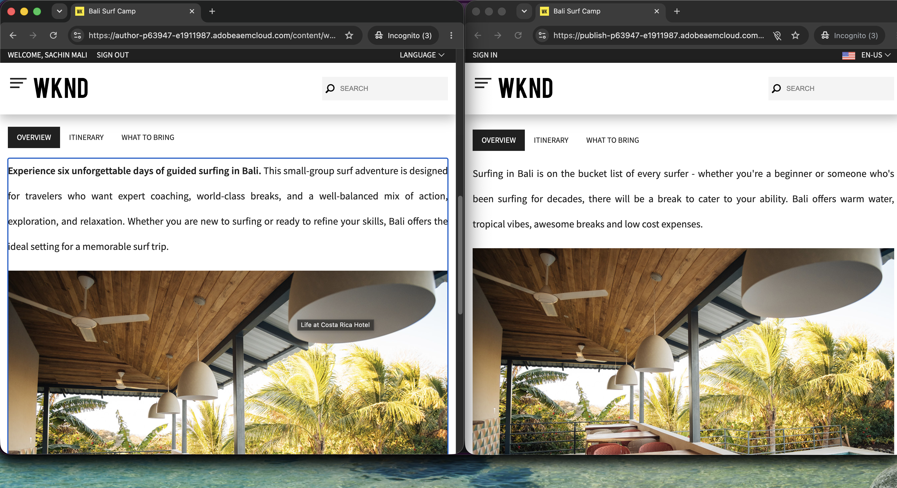
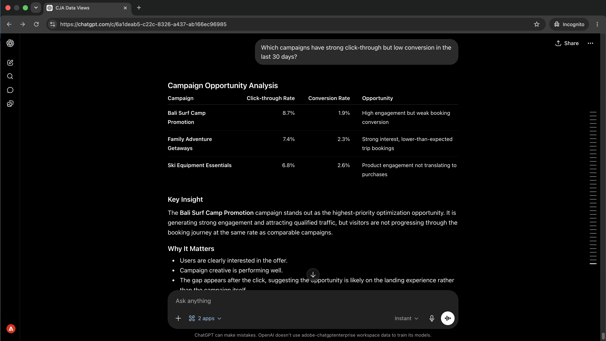
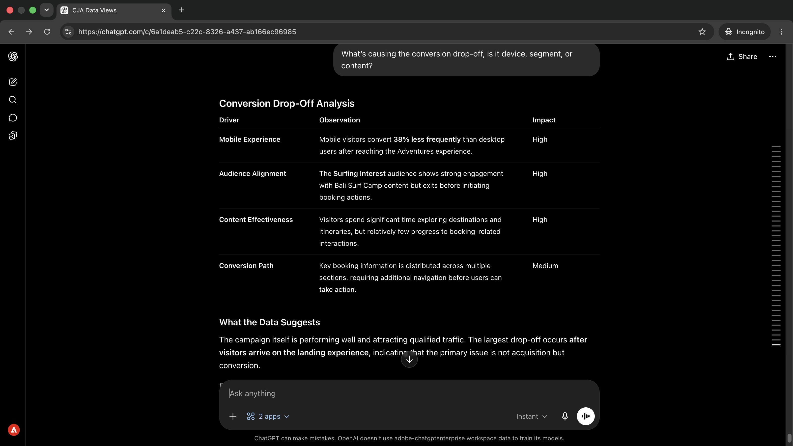
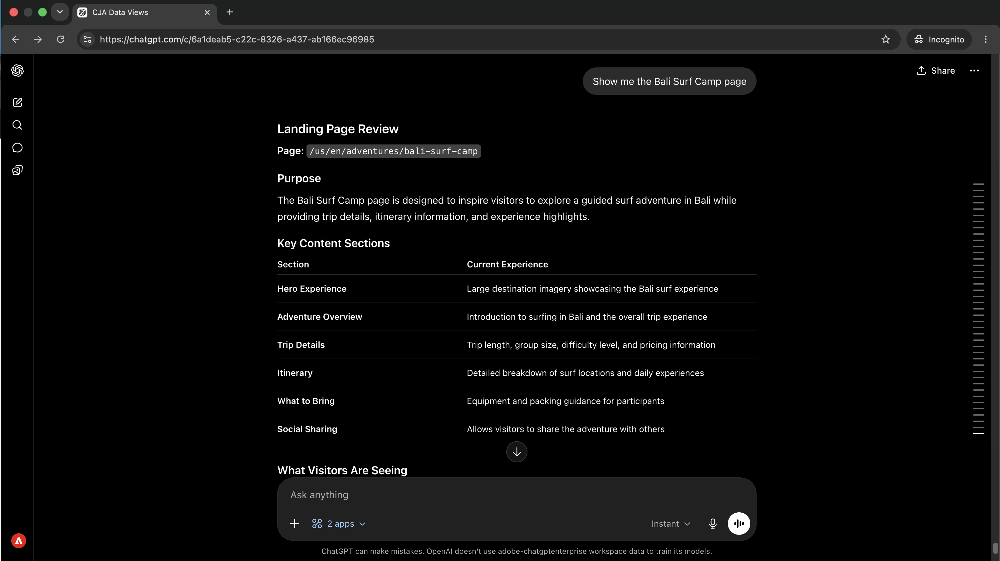
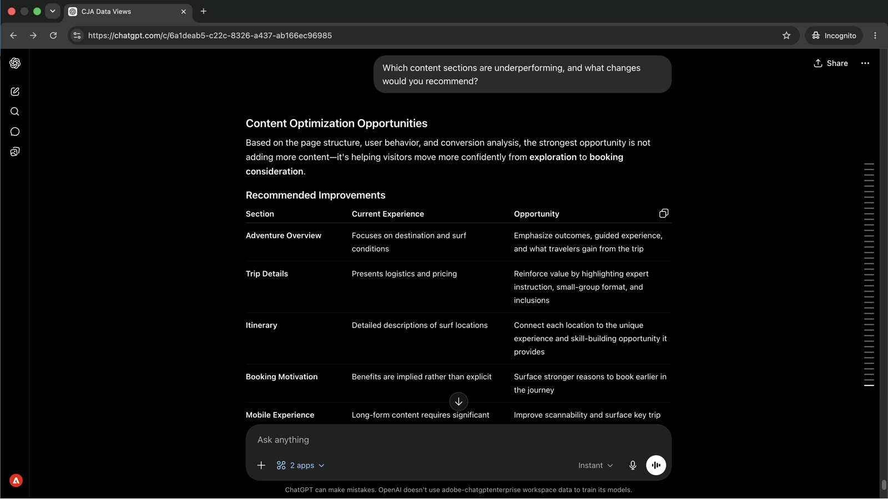
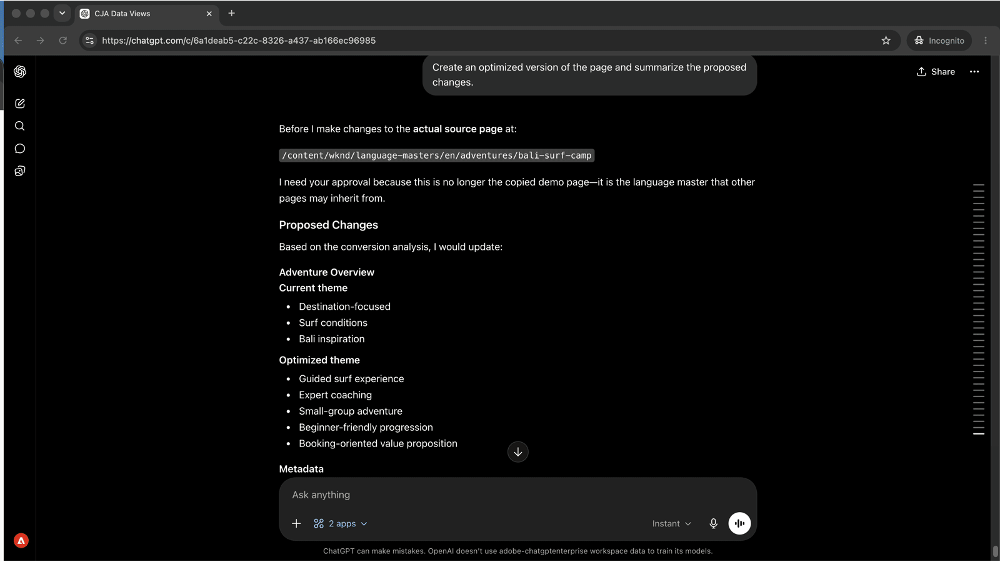

# Combler les écarts de performances du contenu avec des mises à jour pilotées par les données
<!-- last-modified: 2026-06-10 -->

{zoomable="yes"}

*Sélectionner pour effectuer un zoom.*

Les écarts de performances du contenu coûtent cher aux résultats des campagnes. Pour les combler, vous devez généralement basculer entre votre outil d’analyse et votre CMS. Cette présentation montre comment le faire en une seule session d’IA : faire apparaître les campagnes avec des écarts de conversion dans Customer Journey Analytics, diagnostiquer la cause, inspecter le contenu peu performant dans AEM et appliquer des mises à jour sans quitter votre conversation.

| Détails du scénario | |
| --- | --- |
| Applications CX Enterprise | [Customer Journey Analytics](https://experienceleague.adobe.com/fr/docs/analytics-platform/using/cja-overview/cja-overview), [Adobe Experience Manager as a Cloud Service](https://experienceleague.adobe.com/fr/docs/experience-manager-cloud-service/content/overview/introduction) |
| Outils agentiques | [Adobe CX Enterprise Coworker](https://experienceleague.adobe.com/fr/docs/cx-enterprise-coworker/content/home), [Adobe CX Enterprise Coworker pour les plateformes d’IA](../tools/mcp-servers.md#connect-to-your-ai-platform) ou [Customer Journey Analytics MCP Server](../tools/mcp-servers.md) et [AEM MCP Server](https://experienceleague.adobe.com/fr/docs/experience-manager-learn/cloud-service/ai/mcp-servers/overview) |
| Audience | Responsables de campagne, stratèges de contenu, opérations marketing |
| Prérequis | un accès CJA, un accès AEM as a Cloud Service, ainsi qu’une plateforme d’IA Coworker avec les plateformes Coworker for AI ou une plateforme d’IA compatible avec MCP |

Chaque étape affiche une invite représentative et un exemple de réponse de l’IA. Une section **Plus que vous pouvez accomplir** suit pour une exploration supplémentaire dans la même session.


## Avant de commencer

>[!BEGINTABS]

>[!TAB Coworker]

Coworker couvre l’ensemble de cette présentation, sans configuration de serveur requise. [Essayer Un Collègue](https://experienceleague.adobe.com/fr/docs/cx-enterprise-coworker/content/home)

Si vous ne pouvez pas ou ne souhaitez pas utiliser directement Coworker, utilisez-le plutôt à partir de votre propre plateforme d’IA. Consultez l’onglet **Collègues pour les plateformes d’IA**. Si cela ne fonctionne pas non plus pour vous, connectez directement votre plateforme d’IA aux serveurs MCP Customer Journey Analytics et AEM à l’aide des onglets restants.

>[!TAB Collègue pour les plateformes d’IA]

Vous pouvez également effectuer cette présentation avec Coworker pour les plateformes d’IA à partir de votre propre plateforme d’IA. [Configuration de Coworker pour les plateformes d’IA](../tools/mcp-servers.md#connect-to-your-ai-platform) | [Documentation Adobe](https://experienceleague.adobe.com/fr/docs/coworker/content/ai-platforms#set-up-coworker)

>[!TAB Claude.ai]

Connectez les deux serveurs MCP en tant que connecteurs personnalisés. Ajoutez chacun séparément.

1. Accédez à **Paramètres > Intégrations** dans Claude.ai.
2. Sélectionnez **Ajouter un connecteur personnalisé**, saisissez une URL de serveur, puis sélectionnez **Connecter**.
3. Connectez-vous avec votre Adobe ID, puis répétez l’opération pour le deuxième serveur.

| Serveur | Point d’entrée |
| --- | --- |
| Serveur MCP Customer Journey Analytics | `https://cja-mcp.adobe.io/mcp` |
| Serveur MCP AEM | `https://mcp.adobeaemcloud.com/adobe/mcp/aem` |

Configuration complète : [Documentation sur les connecteurs personnalisés Claude.ai](https://support.claude.com/en/articles/11175166-get-started-with-custom-connectors-using-remote-mcp)

>[!TAB ChatGPT]

Connectez les deux serveurs MCP en mode Développeur ChatGPT (Pro, Plus, Business, Enterprise ou Education plan requis). Ajoutez chaque serveur séparément.

1. Activez le **mode Développeur** dans les **paramètres ChatGPT**.
2. Accédez à **Paramètres > Intégrations** et sélectionnez **Ajouter un connecteur personnalisé > Serveur MCP distant**.
3. Saisissez une URL de serveur, sélectionnez **Connexion** et connectez-vous avec votre Adobe ID.
4. Répétez l’opération pour le deuxième serveur.

| Serveur | Point d’entrée |
| --- | --- |
| Serveur MCP Customer Journey Analytics | `https://cja-mcp.adobe.io/mcp` |
| Serveur MCP AEM | `https://mcp.adobeaemcloud.com/adobe/mcp/aem` |

Configuration complète : [Documentation du MCP ChatGPT](https://developers.openai.com/api/docs/guides/tools-connectors-mcp)

>[!TAB Autres plateformes d’IA]

Utiliser Gemini, Microsoft Copilot, Cursor, Claude Code ou un autre environnement compatible avec MCP ? Connectez-vous aux deux serveurs MCP à l’aide des points d’entrée suivants :

| Serveur | Point d’entrée |
| --- | --- |
| Serveur MCP Customer Journey Analytics | `https://cja-mcp.adobe.io/mcp` |
| Serveur MCP AEM | `https://mcp.adobeaemcloud.com/adobe/mcp/aem` |

Instructions de configuration complètes pour toutes les plateformes d’IA prises en charge : [Connexion à votre plateforme d’IA](../tools/mcp-servers.md)

>[!ENDTABS]

>[!NOTE]
>
>Connectez-vous avec votre Adobe ID lorsque vous y êtes invité et sélectionnez l’organisation IMS liée à vos environnements CJA et AEM. Choisir la mauvaise organisation est la source la plus courante d’erreurs d’authentification.
>
>Lors de la première connexion, votre plateforme d’IA peut vous demander de sélectionner une organisation IMS ou de spécifier un sandbox. Une fois ce contexte défini, le serveur MCP l’utilise pour le reste de la session.
>
>Certains outils vous demandent votre approbation avant de s’exécuter. Examinez la demande et approuvez ou refusez. Aucune action n’est entreprise sans votre confirmation.


## Étape 1 : Rechercher des campagnes avec un écart de conversion

Utilisez CJA pour afficher en surface les campagnes où le clic publicitaire est important, mais où le taux de conversion est faible. Ce modèle (intention élevée, remplissage faible) indique généralement un problème de contenu ou d’expérience sur la page de destination.

```
Which campaigns have strong click-through but low conversion in the last 30 days?
```

+++Voir un exemple de réponse

{zoomable="yes"}

*Sélectionner pour effectuer un zoom.*

+++


## Étape 2 : diagnostiquer la cause première

Effectuez un suivi pour comprendre ce qui cause l’écart. Demandez si la liste déroulante est concentrée sur un type d’appareil, un segment d’audience ou une interaction de contenu spécifique.

```
What's causing the conversion drop-off, is it device, segment, or content?
```

+++Voir un exemple de réponse

{zoomable="yes"}

*Sélectionner pour effectuer un zoom.*

+++


## Étape 3 : vérifier le contenu dans AEM

Une fois la campagne peu performante identifiée, extrayez la page de destination d’AEM au cours de la même session. Voir ce que dit actuellement la page est le point de départ pour comprendre ce qu’il faut changer.

```
Show me the Bali Surf Camp page.
```

+++Voir un exemple de réponse

{zoomable="yes"}

*Sélectionner pour effectuer un zoom.*

+++


## Étape 4 : obtenir des recommandations ciblées

Demandez à votre plateforme d’IA de connecter ce que les données ont affiché à ce qui se trouve sur la page. L’IA a besoin de plusieurs sources pour identifier les sections de contenu susceptibles d’entraîner cette baisse et les éléments à modifier.

```
Which content sections are underperforming, and what changes would you recommend?
```

+++Voir un exemple de réponse

{zoomable="yes"}

*Sélectionner pour effectuer un zoom.*

+++


## Étape 5 : appliquer et réviser les modifications

Demandez à votre plateforme d’IA de créer une version optimisée de la page en fonction des recommandations et de résumer ce qui a changé et pourquoi.

```
Create an optimized version of the Bali Surf Camp page and summarize the proposed changes.
```

+++Voir un exemple de réponse

{zoomable="yes"}

*Sélectionner pour effectuer un zoom.*

+++


>[!CAUTION]
>
>Examinez le résumé complet des modifications proposées avant de confirmer. Le serveur MCP AEM écrira les modifications dans votre environnement AEM. Les pages restent à l’état publié jusqu’à ce que vous les republiiez explicitement.


## Ce que vous avez accompli

Vous avez connecté Customer Journey Analytics et AEM en une seule session d’IA et déplacé les données de campagne vers les modifications de contenu déployées sans changer d’outil. Vous avez identifié des campagnes avec des écarts de conversion, diagnostiqué la cause première, inspecté la page de destination, reçu des recommandations ciblées basées sur les données et le contenu et appliqué les modifications dans la même conversation. Cela permet de raccourcir la boucle des commentaires entre Analytics insight et le contenu publié, et de mettre à l’échelle un nombre illimité de pages peu performantes au cours de la même session.


## Plus de choses à accomplir

Lorsque CJA et AEM sont connectés au cours de la même session, vous pouvez couvrir l’ensemble du cycle, de l’identification des problèmes aux correctifs d’expédition. Développez un scénario ci-dessous pour afficher les invites que vous pouvez essayer.

+++Recherche du contenu qui freine les performances

Un trafic élevé avec un faible engagement signale un problème de contenu, pas un problème de trafic. Ces invites vous aident à faire apparaître des pages et des modèles spécifiques qui nécessitent une attention particulière avant qu&#39;une échéance de campagne ne force le problème.

**Invites**

```
Which campaigns have the highest traffic but lowest conversion rate this quarter?
```

```
Which pages have a high bounce rate but also high traffic?
```

```
Compare engagement rates for landing pages across email and paid social campaigns.
```

```
Find AEM pages linked from active campaigns that haven't been updated in over 60 days.
```

+++

+++Correction de ce que les données vous indiquent de corriger

Une fois que vous savez ce qui est peu performant, effectuez des modifications ciblées en fonction de ce que les données de performance ont révélé. Ces invites permettent de mettre à jour des sections spécifiques en fonction du diagnostic.

**Invites**

```
Update the CTA on the [page name] page to better match the campaign audience.
```

```
Rewrite the hero headline on the [page name] page to address the mobile drop-off.
```

```
Add a trust signal to the [page name] page above the conversion form.
```

```
Which pages updated in this session still need to be published?
```

+++

+++Améliorations des expéditions avant la prochaine campagne

Les modifications apportées en milieu de session peuvent s’accumuler rapidement. Ces invites vous aident à vérifier ce qui est prêt, à regrouper les mises à jour pour révision et à effectuer une promotion propre avant qu’une campagne ne soit activée.

**Invites**

```
Show me all pages updated in this session that are still unpublished.
```

```
Create a launch with all changes from this session for review before publishing.
```

```
Give me a summary of all changes made in this session.
```

```
Publish all confirmed changes and share the updated URLs.
```

+++


## Informations supplémentaires

| Ressource | Ce que vous trouverez |
| --- | --- |
| [Serveur CJA MCP dans le registre IA](https://developer.adobe.com/ai-registry/#/mcp/cja-mcp){target="_blank"} | Disponibilité et outils du serveur CJA MCP |
| [Documentation du serveur AEM MCP](https://experienceleague.adobe.com/fr/docs/experience-manager-learn/cloud-service/ai/mcp-servers/overview){target="_blank"} | Disponibilité et outils du serveur AEM MCP |
